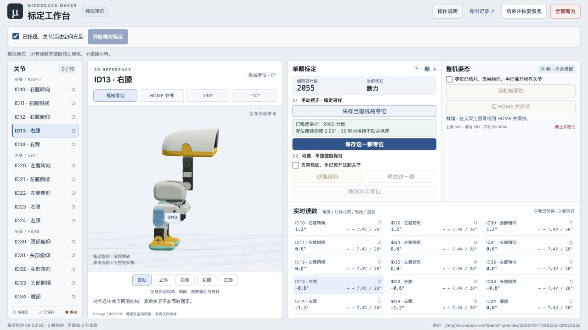

# MicroDuck Maker

**把 MicroDuck 从装配、标定到日常维护会用到的工具，放进一个持续维护的项目。**

[工具目录](tools/README.md) · [标定工具使用说明](tools/calibrator/README.md) · [装配对照](tools/servo-guide/README.md) · [下载发布包](https://github.com/lxm/microduck-maker/releases) · [反馈问题](https://github.com/lxm/microduck-maker/issues)

## 现在可以用什么

| 工具 | 用途 | 入口 |
|---|---|---|
| 逐关节零位标定 | 单屏 3D 工作台、逐颗标定、回零 / HOME、保持与备份 | [tools/calibrator](tools/calibrator/) |
| 舵机编号与装配对照 | 飞特 HD-1910 版的 15 颗舵机位置、编号与装配检查 | [tools/servo-guide](tools/servo-guide/) · [在线查看](https://lxm.github.io/microduck-servo-guide/) |
| 零位标定支架 | 6 件 STL、装配参考与代打说明 | [tools/zero-fixture](tools/zero-fixture/) |
| 硅胶脚底翻模（正在尝试中） | 左右脚两片式模具、打印尺寸和浇注方法，木地板防滑效果待实测 | [下载模具与使用方法](tools/silicone-sole-mold/) |
| 颈部舵机连接板 | D0.8.1 原配胶壳短线焊接版：KiCad、板级 3D、单板／六联制造文件与接线说明 | [tools/neck-interconnect](tools/neck-interconnect/) |

仓库包含标定与装配工具的源码、第三方资源、使用说明和离线验证程序，以及零位标定支架的 STL 打印文件（不含支架 STEP）、颈部连接板的可编辑 PCB 和板级 STEP。支架保留原设计，已知配合问题和来源说明见其目录。颈部板当前收录原配胶壳短线穿孔焊接版，替代端子试装版待验证后单独发布。

## Orange Pi Zero 3W 固件

基于 [kissqy/Microduck-kissqy（`d4d21c1`）](https://github.com/kissqy/Microduck-kissqy/tree/d4d21c1073d2c12ad2b5dfe3deb031030f7792ef)，保留原有机器人应用、模型和 ToF 源码，由 MicroDuck Maker 在 Armbian 26.8.1 上适配串口、HAT I²C 和音频。

摄像头版镜像请从 [Orange Pi 固件 Actions](https://github.com/lxm/microduck-maker/actions/workflows/orangepi-image.yml) 的成功构建下载。下方固定发布版 exp.1 早于摄像头适配。

[下载 exp.1 完整刷卡镜像（.img.xz）](https://github.com/lxm/microduck-maker/releases/download/orangepi-zero3w-exp.1/Microduck_OrangePiZero3W_Experimental.img.xz) · [SHA-256 校验文件](https://github.com/lxm/microduck-maker/releases/download/orangepi-zero3w-exp.1/SHA256SUMS) · [刷卡与首次启动说明](firmware/orangepi-zero3w/)

这是面向 Allwinner A733、1 GB、PCB V1.5 的实验镜像，已离线校验，尚未验证本发布镜像的实机启动。

## 先体验标定工具

电脑安装 Python **3.10+**，然后运行：

```sh
git clone https://github.com/lxm/microduck-maker.git
cd microduck-maker/tools/calibrator
python3 server.py --demo
```

打开 <http://127.0.0.1:8795/>。默认即为模拟模式，可以体验选关节、采样、保存和保持流程，不连接机器人。下载资源均包含在仓库中，不需要 npm 或在线 CDN。

需要另一台电脑访问时，在启动命令后加 `--bind 0.0.0.0`，然后用浏览器打开 `http://服务电脑的IPv4地址:8795/`。具体步骤与连接排查见 [局域网访问说明](tools/calibrator/docs/usage.md#从另一台电脑访问)。



实机标定还需要兼容的板端运行环境与 SSH。先读 [适用范围与连接方法](tools/calibrator/README.md#适用范围)，再按 [详细操作说明](tools/calibrator/docs/usage.md) 执行。机械零位和站立 HOME 是不同概念，3D 参考按钮只改变画面。

## 项目结构

```text
microduck-maker/
├── tools/
│   ├── calibrator/       # 标定网页、板端代理、测试与说明
│   ├── servo-guide/      # 3D 舵机编号与装配对照
│   ├── zero-fixture/     # 零位标定支架 STL 与打印说明
│   ├── silicone-sole-mold/ # 硅胶脚套模具与浇注说明（正在尝试中）
│   └── neck-interconnect/ # 颈部连接板、板级模型与接线／打板说明
├── firmware/             # 按板型维护的固件源码与镜像构建说明
├── docs/                 # 项目维护与发布说明
├── scripts/              # 全仓库离线验证
├── .github/workflows/    # 自动校验
├── LICENSE              # 原创代码的 MIT 许可
└── THIRD_PARTY_NOTICES.md
```

每个工具在自己的目录内说明依赖、启动方式、兼容范围和来源，能够独立使用。后续新增工具继续放到 `tools/<工具名>/`，固件按板型放到 `firmware/<板型>/`。

## 开发与验证

安装 Python 3.10+ 和 Node.js。Node.js 仅用于 JavaScript 语法校验，不是标定工具的运行依赖。

```sh
python3 scripts/validate.py
```

验证包含标定工具及串口发现/依赖准备的离线测试、3D 引用文件哈希、网页静态资源，以及装配对照的网格、69 个装配变换和 15 个舵机编号、颈部板文件与制造包完整性。验证不连接机器人、不操作串口、不上传程序或改写实机。

当前工作台增加单屏布局与回 HOME 操作；离线测试通过不等同于跨机型实机验收。兼容条件及已知边界见各工具说明。贡献与发布方式见 [CONTRIBUTING.md](CONTRIBUTING.md) 和 [发布说明](docs/releasing.md)。

## 来源与许可

- lxm 原创的标定界面、维护代理、脚本，以及装配对照的原创网页和提取代码采用 [MIT](LICENSE)。
- 标定工具引用的 Kissqy 参考代码保留其**个人非商业使用许可**；其 3D 模型与 Three.js 分别保留上游模型许可、MIT 许可。
- 装配工具的 CAD 衍生模型采用 **CC BY-NC-SA 4.0**，保留机械行者Robo、fanhao375 和 Pollen Robotics 的署名。
- 零位标定支架来自交流群分享，暂无原始发布链接，作者与模型许可尚未确认；其 STL 与模型截图不纳入软件 MIT 许可，详见该目录说明。
- 颈部板的原创 PCB、简化接线模型、脚本与说明适用 MIT；原配胶壳模型为示意，原厂舵机 CAD 未打包，见 [资料来源](tools/neck-interconnect/d0.8.1/docs/provenance.md)。
- 不同目录的许可范围见 [THIRD_PARTY_NOTICES.md](THIRD_PARTY_NOTICES.md)。MIT 不覆盖上述单独授权的资源，不能将整个下载包理解为统一 MIT 授权。

这是独立社区项目，与 Pollen Robotics、飞特及所引用社区项目无官方隶属或背书关系。现有 [microduck-servo-guide](https://github.com/lxm/microduck-servo-guide) 仓库和在线页面继续保留，新项目统一收录后续工具源码。

English: A growing collection of MicroDuck maker tools for assembly, servo zero calibration and maintenance. The calibration UI runs locally with an offline demo; hardware mode requires a compatible HD1910 robot environment. Third-party code and model assets retain their own licenses.
