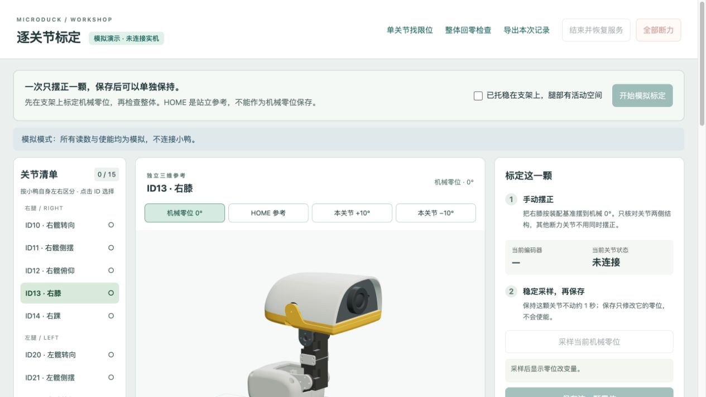

# MicroDuck 逐关节零位标定

**手动摆正一颗，稳定采样，保存这一颗的零位；需要时单独保持，再继续下一颗。**

[完整操作说明](docs/usage.md) · [实机兼容条件](docs/compatibility.md) · [来源与许可](../../THIRD_PARTY_NOTICES.md) · [返回工具目录](../README.md)



## 功能

- 按 15 个舵机 ID 选择关节，查看机械零位、HOME、当前关节 ±10° 的独立 3D 参考。
- 单颗稳定采样和 EEPROM 零位保存；保存不会自动使能。
- 可选低输出保持、释放、撤销本次会话中的单颗修改。
- 嘴部独立采样自然闭合与舒适张开端点。
- 全部归零检查，以及仅 ID14/24 舵盘对中。
- 原始寄存器备份、逐步日志和 JSON 导出。
- 单关节疑似限位重复测量和悬空踏步实验，见详细说明；这些功能会驱动实机，不是自动零位计算。

## 快速启动

电脑需要 Python **3.10+** 和支持 WebGL 的现代浏览器。模拟模式和电脑侧网页服务不需要第三方 Python 包。

在仓库根目录执行：

```sh
cd tools/calibrator
python3 server.py --demo
```

打开 <http://127.0.0.1:8795/>。不加参数也是模拟模式。macOS/Linux 也可以用 `./run.sh --demo`。Windows 使用 `python server.py --demo`，实机连接还需要系统可用的 OpenSSH `ssh` 和 `scp`。

端口冲突时：`python3 server.py --demo --port 8796`。关闭服务按 Ctrl+C；服务仅监听 `127.0.0.1`，请在运行该服务的电脑上打开网页。不要直接双击 HTML，也不要只用静态 HTTP 服务代替 `server.py`。

## 适用范围

实机端要求 Linux、systemd、兼容 HD1910 维护反馈的 robotd，以及 15 颗 HD1910（ID 10–14、20–24、30–34），单圈 mode 4、1 Mbps；身体方向约定为 −1。板端还需要 Python 3.10+、pyserial、fuser、可用的非交互 sudo 和 SSH 密钥登录。

支持的串口参数是 `/dev/serial0` 和 `/dev/ttyS2`。**不是任意 MicroDuck 固件都能直接使用**：板端服务名、原生状态字段、锁与配置路径的具体要求见 [compatibility.md](docs/compatibility.md)。不同舵机型号、编号或模式不能直接套用。3D 外形来自上游参考模型，不代表 HD1910 的实际外观。

标定、单颗保持已有先前实机使用记录；本次整理只做离线与模拟验证，没有重新连接机器人。整体回零曾在 ID30 跟随误差保护处中止，因此不能宣称已经完成全身到位验收；疑似限位测量也没有实机精度结论。

## 连接实机

先核对兼容条件，固定躯干、给腿部和头颈留出空间，并确认断力。在本目录运行，替换示例用户名和主机名：

```sh
# Zero 3W：只保存 EEPROM 零位，不读写机器人配置文件
python3 server.py --ssh radxa@robot.local --serial-port /dev/ttyS2 --eeprom-only

# 使用已有兼容 JSON 标定配置的树莓派环境
python3 server.py --ssh user@robot.local --serial-port /dev/serial0
```

启动网页服务不会连接串口；在页面勾选支撑条件并点击进入标定后，才临时上传板端代理、检查状态、备份并独占串口。`--eeprom-only` 仍然会改写所选舵机的 EEPROM；它表示不访问机器人标定配置文件，不表示只读模式。

完整顺序：**进入 → 选关节 → 手动摆正 → 采样 → 保存 → 可选保持 → 下一颗 → 结束并恢复服务**。详细的嘴部端点、整体回零、停止、备份和恢复方法见 [使用说明](docs/usage.md)。标定期间手柄服务暂停；网页断力按钮不是硬件急停。

## 文件与记录

```text
server.py / run.sh             # 电脑侧网页与 SSH 入口
agent.py                      # 临时板端维护代理
core.py / storage.py          # 标定事务、保持、备份与配置保存
limit_probe.py                # 疑似限位重复测量
zero.py                       # 板端独立归零检查
gait_test.py / run-gait-test.sh # 悬空踏步实验
static/                       # 界面、3D 参考及固定第三方资源
test_*.py                     # 离线测试
docs/                         # 使用、兼容性与界面截图
```

电脑记录默认写入 `~/.microduck-calibrator/`，板端记录写入 `/opt/robot/calibration-backups/`；这些记录不属于源码，不应提交到公共仓库。嘴部端点和 EEPROM 偏移均应以自己的实机记录为准，不能复制他人的标定值。

## 开发验证

在本目录执行：

```sh
python3 -m unittest discover -v
```

当前包含 113 项测试，覆盖单颗写入、回滚、保持、归零、失联清理、串口适配、仅 EEPROM 模式和疑似限位测量。全仓库资源与来源校验在仓库根目录运行 `python3 scripts/validate.py`。

## 许可

本工具原创代码采用仓库根目录的 [MIT](../../LICENSE)。`static/source/` 引用 Kissqy 固定提交 `3d2b210dae8cd78b20f090fe7bed8c6a49bb7108` 的参考代码、模型和 Three.js，保留其各自许可；原始文件清单与哈希见 `static/source-manifest.json`。其中 Kissqy 原创参考代码是个人非商业使用许可，不能因本仓库 MIT 许可而改作商业授权。
