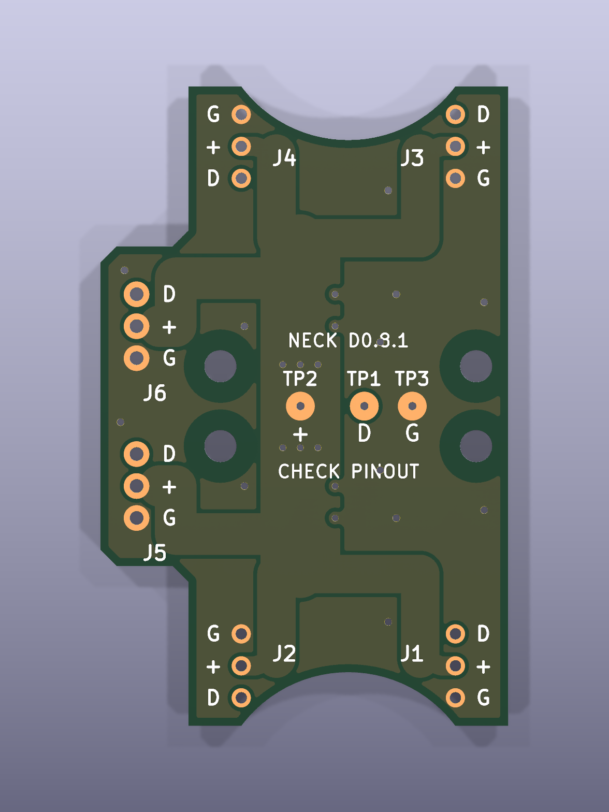
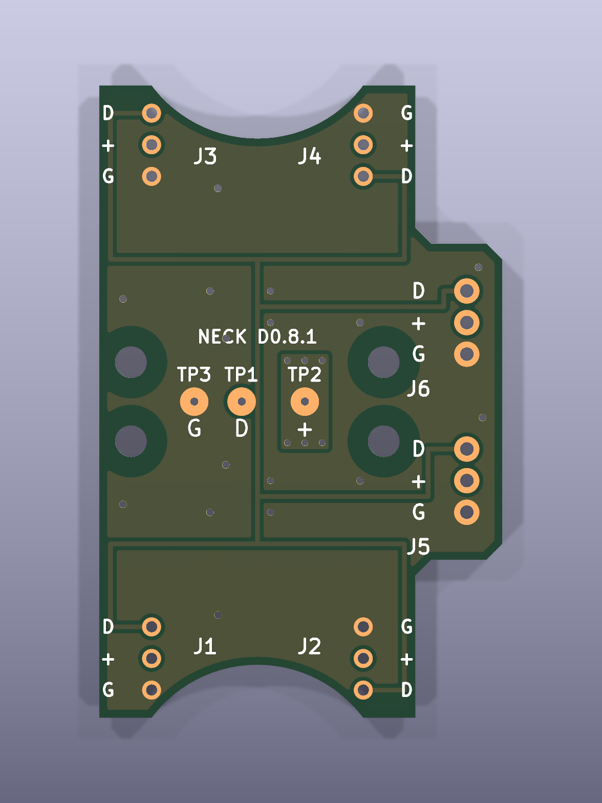

# D0.8.1 原配胶壳短线穿孔焊接版

整理日期：2026-11-02。设计快照：2026-11-01。

本版保留原配 AMP2.0 胶壳、压接触点和短线，裸线端穿过 J1–J4 的原通孔，在 PCB 外侧焊接。板厚 1.6mm，主体宽 20mm、包围尺寸 25.5×40mm，四个固定孔，外接凸台在正面左侧。PCB 直接贴舵机参考安装面，没有垫高结构；接头和线长以实物试装确定。

相比旧 D0.8，已修正 J1/J2 的 DATA/GND 铜网与编号，补齐六个端口及三个测试点的双面丝印，测试点加大为 Ø1.8mm 焊盘／Ø0.5mm 孔。旧错误包未收录。这里没有替代排母焊盘、大搭焊接线焊盘或 7343 电容封装。

## 下载与打开

- [KiCad 工程](pcb/neck_D0.kicad_pro)、[PCB](pcb/neck_D0.kicad_pcb)、[原理图](pcb/neck_D0.kicad_sch)。整目录下载后，用 KiCad 10 打开工程；本地符号库、封装库与模型按相对路径组织。
- [不含舵机的 PCB 查看副本](pcb/neck_D0_8_1_no_servos.kicad_pcb)、[完全裸板查看副本](pcb/neck_D0_8_1_bare_pcb_view.kicad_pcb)。主工程同样只收录板级模型。PCB 编辑器中用“视图 → 3D 查看器”查看，切换正反面。
- [板级 STEP](mechanical/KiCad_Neck_D0_8_1_PCB_only.step)，可用 FreeCAD 等查看。包含 PCB、铜与简化连接器／线端模型，不含原厂舵机 CAD。
- [单板 Gerber ZIP](fabrication/D0_8_1_1oz_single/MicroDuck_Neck_D0.8.1_1oz_single_25.5x40_PINOUT_CHECK.zip)、[六联 Gerber ZIP](fabrication/D0_8_1_1oz_6up/MicroDuck_Neck_D0.8.1_1oz_6up_94.5x96_PINOUT_CHECK.zip)。在 GitHub 文件页点击下载原始文件，再将 ZIP 上传打板平台。
- [物料表](bom.csv)、[接线装配](docs/assembly.md)、[针序表](docs/pinout-and-testpoints.md)、[打板参数](docs/fabrication.md)。

## 正反面

下图为裸板，不显示连接器。F 面朝外，B 面朝舵机。正面凸台在左，翻到背面后自然显示在右侧。

## 供电与验收状态

六个端口并联：1=DATA，2=VBUS_SERVO，3=GND。**+ 为电池母线，2S 最高 8.4V；本板没有降压电路。** 头部若使用 Zero 3W 等主板，应由对应供电电路降压后接入，不能把该 + 直接当作 5V。

本版内部 ERC、DRC、针序、丝印、测试点、六联一致性及 Gerber 导出检查通过。整理后再次运行主工程 ERC、DRC 和原理图一致性检查；[当前打包 DRC](validation/packaged-drc.json)、[ERC](validation/packaged-erc.json)、[文件清单](manifest.json)及[原检查记录](validation/original/)一并保留。

J1/J2 的修正来自先前实物错误反馈；**J5/J6 外接线束另一端极性仍待实物核对**。短线穿孔、螺钉规格和有效深度、完整运动范围、接线抗拉及实际负载温升也尚未完成样板验收。检查通过表示文件内部一致，不表示整机配合已经验证。使用前按装配说明逐项核对。

PCB、原创脚本和说明适用仓库 MIT 许可。连接器模型按尺寸简化，原配胶壳／线端仅作装配示意，不是供应商精确 CAD 或替代接头认证。来源与整理改动见 [provenance.md](docs/provenance.md)。
