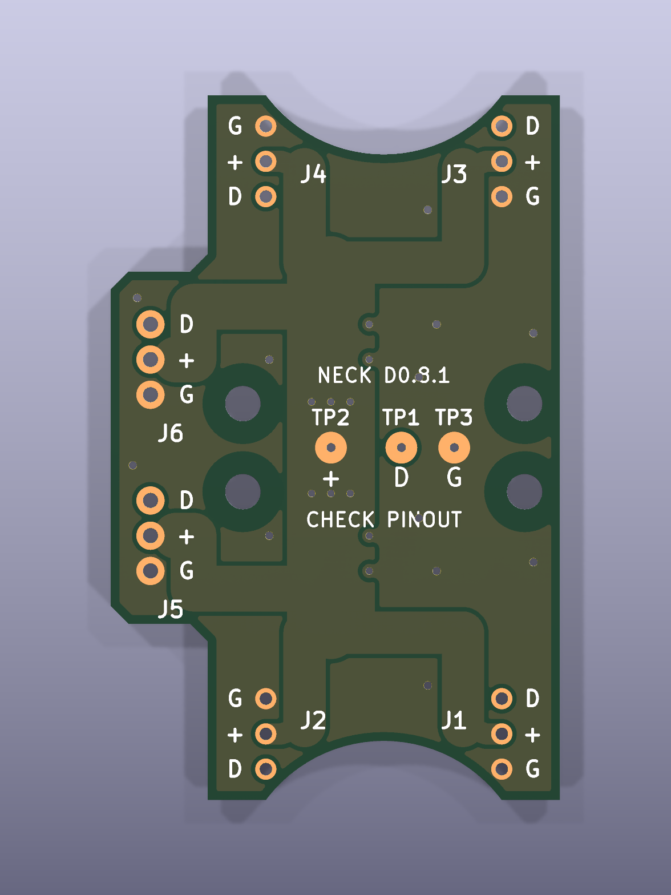
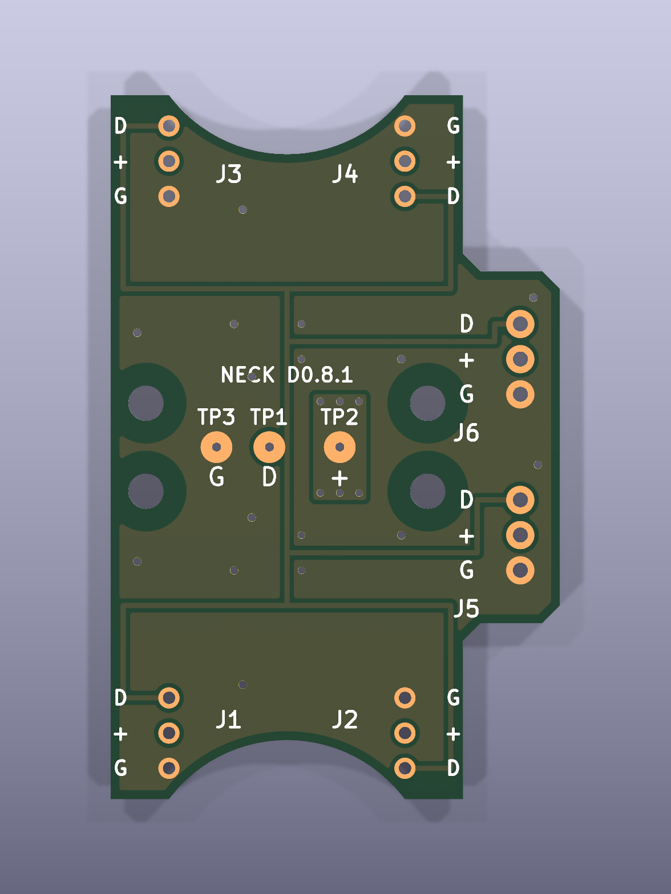

# 针序与测试点

观察方向：外侧F.Cu朝向自己，左侧为凸台，NECK文字正向。坐标为原设计安装投影毫米坐标。

| 位置 | 位号 | 从上到下 |
| --- | --- | --- |
| 上左舵机接线 | J4 | G / + / D |
| 上右舵机接线 | J3 | D / + / G |
| 下左舵机接线 | J2 | G / + / D |
| 下右舵机接线 | J1 | D / + / G |
| 左凸台上座 | J6 | D / + / G |
| 左凸台下座 | J5 | D / + / G |

| 测试点 | 正面位置X,Y | 网络 | 焊盘/孔径 |
| --- | --- | --- | --- |
| TP2 + | -3,25 | VBUS_SERVO | Ø1.8 / Ø0.5mm |
| TP1 D | 1,25 | DATA | Ø1.8 / Ø0.5mm |
| TP3 G | 4,25 | GND | Ø1.8 / Ø0.5mm |

所有端口和三个测试点均有双面丝印；背面观察左右镜像，以对应焊盘边的文字为准。J5/J6保持原A2007WV-3P的位置和方向，位号与六拼编号N1–N6分开。

按逻辑脚号，J1–J6各自1脚到TP1 DATA导通、2脚到TP2 VBUS导通、3脚到TP3 GND导通。检查不同三网互不短路。原配线材颜色不作为极性依据。J1/J2修正依据为用户之前指出的D0.8实物不符；J5/J6实际外接线束另一端仍需核对。
