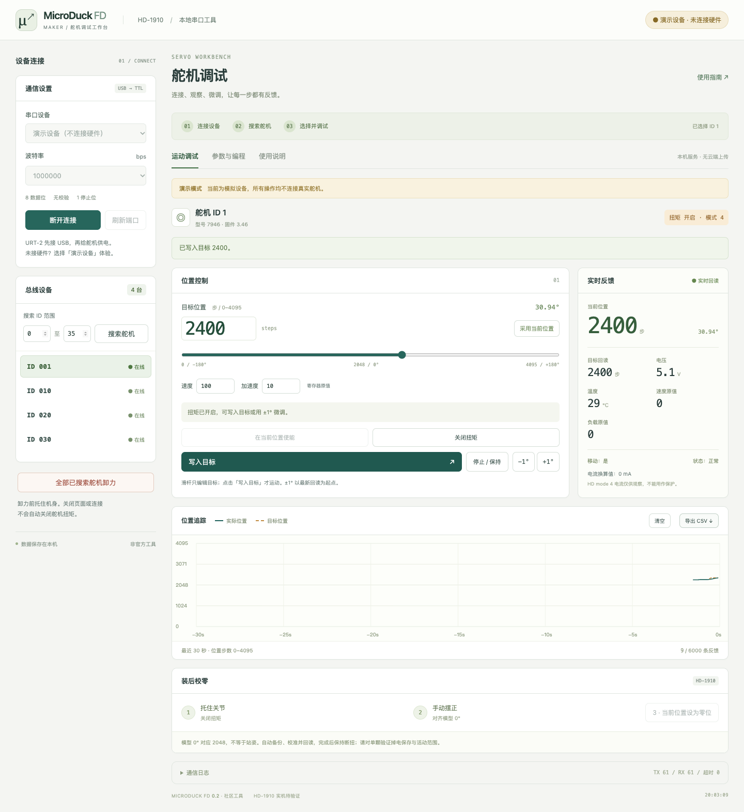

# MicroDuck FD · 飞特舵机调试工作台

直接用电脑 USB 串口连接飞特 HD-1910，完成搜索、单颗微调、反馈观察、校零和参数维护。界面运行在本机浏览器中，不需要机器人主板、SSH、Wine 或浏览器串口授权。

这是独立实现的社区工具，**不是飞特官方 FD 的移植版**。当前主要支持 macOS，写操作针对型号值 **7946** 的 HD-1910；运动控制支持位置模式 **0 / 4**。无硬件时可使用演示设备。



## 启动

### macOS 双击启动

安装 Python **3.9+**，在 Finder 中打开本目录，双击 [启动调试工具.command](启动调试工具.command)。

首次启动会在 `~/Library/Application Support/MicroDuck FD/venv` 创建独立 Python 环境，联网安装 `pyserial==3.5`，之后可离线使用。脚本自动启动服务并打开浏览器；保留终端窗口即可继续使用。

默认使用随机空闲端口，实际地址会显示在终端，例如 `http://127.0.0.1:53594`。不要直接双击 `index.html`，网页需要 Python 服务访问串口。

如果双击未启动，可在仓库根目录执行：

```sh
zsh tools/servo-debug/启动调试工具.command
```

需要固定地址时：

```sh
zsh tools/servo-debug/启动调试工具.command --http-port 8766
```

浏览器未自动打开时，访问终端打印的地址。端口被占用时去掉 `--http-port` 自动选择空闲端口，或换一个端口。

### 手动启动

从本工具目录执行：

```sh
python3 -m venv .venv
.venv/bin/python -m pip install -r requirements.txt
.venv/bin/python fd_mac.py --http-port 8766
```

`--no-browser` 可以关闭自动打开浏览器。服务仅监听 `127.0.0.1`，请在运行服务的同一台电脑上打开；窄屏布局适用于浏览器小窗口，不能直接从手机访问电脑地址。Linux / Windows 可使用 Python 服务，但本版本未完成这两个平台的串口实测，`.command` 入口仅适用于 macOS。

## 先用演示设备熟悉操作

1. 左侧「串口设备」选 **演示设备（不连接硬件）**，点击「连接设备」。顶部会显示黄色演示提示。
2. 点击「搜索舵机」，默认出现 **ID 1、10、20、30**，自动选中第一颗。可在左侧切换设备。
3. 观察当前位置与目标回读，点击「在当前位置使能」，再用 **±1°** 微调。
4. 修改数字或滑杆只编辑目标；点击「写入目标」才发送运动。目标距最新位置超过 10° 时需要确认。
5. 点击「关闭扭矩」，再试用「当前位置设为零位」。模拟位置将回读为 2048，保持断扭。
6. 切换到「参数与编程」读取参数，按名称、地址或区域筛选，保存 JSON 或载入 JSON 对照。

演示有四颗设备，修改 ID 会被「总线仅允许一颗」检查拒绝。这是预期行为。演示验证操作与模拟寄存器流程，不证明真实固件、速度、电流或机械行程兼容。

## 连接真实 HD-1910

准备 USB 数据线、USB 转 TTL 总线转接器（如 URT-2）、舵机及匹配的电源。按实际转接器和舵机标识核对信号、电源、地；不要仅按线色判断。使用舵机对应规格的电源。

1. 先接转接器的 USB，再给舵机供电。关闭占用同一串口的 FD、servo-web、robotd 或其他调试程序。
2. 刷新端口并选择 `/dev/cu.*`。HD-1910 默认波特率为 **1000000**；如果曾修改，选择设备的实际波特率。
3. 点击「连接设备」→「搜索舵机」。默认范围 **0–35**，可扩大至 **0–253**。
4. 点击一颗舵机，核对型号、位置、电压、温度与扭矩状态。打开、搜索、选择都不写运动目标，也不主动开启扭矩。
5. 托住关节并确认活动空间，点击「在当前位置使能」。先用 ±1° 验证方向与机械余量，再明确写入目标。

相同出厂 ID 的多个舵机无法靠扫描可靠区分。首次配 ID 必须逐颗连接。断连或重新搜索会清空旧读数；通信失败或反馈过期时，运动写入暂停，读取恢复后重新开放。程序仍保留关闭扭矩与已搜索设备卸力入口。

## 工作区与操作

| 区域 | 使用方法 |
|---|---|
| 通信设置 / 总线设备 | 连接、设置搜索范围、切换单颗设备；顶部步骤提示当前进度 |
| 位置控制 | 数值 / 滑杆编辑目标；「采用当前位置」只复制读数，不运动；使能后才可写目标或微调 |
| 实时反馈 | 当前与目标位置、电压、温度、速度、负载、扭矩及通信状态 |
| 位置追踪 | 显示最近 30 秒；绿色实线为实际位置，琥珀虚线为目标；最多保存 6000 条反馈 |
| 参数与编程 | 读取内存表、筛选参数、逐项写入、保存 JSON、载入文件对照、修改 ID 与重启 |
| 通信日志 | 点击展开，查看结果、错误及自动备份路径 |
| 使用说明 | 界面内的连接、微调、校零、备份及常见问题指南 |

**速度与加速度是寄存器原值**，不是 °/s 等物理单位；HD mode 4 中限速效果和电流反馈不能作为可靠保护。`停止 / 保持` 是把目标设为当前读数，扭矩状态不变，不是卸力或硬件急停。

### 装后校零

1. 托住关节，点击「关闭扭矩」，确认反馈为关闭。
2. 手动摆到模型关节 **0°**。机械零位对应 **2048**，站立 HOME 不等于所有关节零位。
3. 点击「当前位置设为零位」并确认。程序先自动备份，再发送 HD/HLS **0x0B** 校准指令并回读，完成后保持断扭。
4. 对单颗先检查掉电重启后的零位保存，再验证完整活动范围。校准改变坐标，旧姿态需要重录。

校零不能消除机械干涉，也不能保证编码器边界附近的全行程。结合 [零位支架](../zero-fixture/README.md) 和 [舵机编号与装配对照](../servo-guide/README.md) 使用。

### 参数修改与 ID 分配

在「参数与编程」读取参数后编辑单项，点击该行「写入」。写入前关闭扭矩；EEPROM 修改会自动备份、解锁、写入回读并重新上锁。身份、通信、运动与校准相关寄存器保留只读或使用专用流程；波特率和应答等级不开放直接写入。

修改 ID 时**物理断开其他舵机，只保留目标一颗**，搜索并选择它，关闭扭矩，填写 0–253 范围内的新 ID，点击「修改 ID」。程序会检查单设备总线，备份并验证新 ID，再重新上锁。多个舵机同 ID 无法被这个检查可靠识别，不能省略物理隔离。

「重启舵机」同样要求关闭扭矩；重启后等待回读，必要时重新搜索。

### 导出与备份

- **CSV**：导出当前所选舵机的已采集反馈（最多 6000 条），由浏览器下载。切换舵机、重新搜索、断开或刷新会清空页面曲线数据，请先导出。
- **保存 JSON**：重新读取当前寄存器并下载快照，格式为 `microduck-fd-v1`。
- **载入 JSON 对照**：显示文件值与当前值差异，**不自动写回**，不支持官方 `.xdat`。
- **自动备份**：校零、改 ID 与 EEPROM 修改前写到 `~/Library/Application Support/MicroDuck FD/`。演示文件带 `demo-` 前缀，具体路径见通信日志。备份失败时会拒绝该操作。

备份和配置留在本机，不放进仓库。工具不提供批量自动恢复，以免覆盖设备身份、通信与坐标参数。

### 结束使用

先托住机身 → 关闭当前扭矩或点击「全部已搜索舵机卸力」→ 核对反馈与日志 → 断开连接。卸力仅覆盖本次搜索得到的 ID，并会报告失败项。

关闭网页、连接或终端**不会自动卸力**。终端按 `Ctrl+C` 停止 HTTP 服务。不要同时打开多个调试会话占用同一串口。

## 常见问题

| 现象 | 排查 |
|---|---|
| 没有串口 | 使用可传数据的 USB 线，重插后刷新；确认实际转接器芯片，再安装对应 macOS 驱动 |
| 串口被占用 | 退出其他串口程序；旧工具仍在运行时先在其页面断开，避免两个服务争用 |
| 搜索 0 台 | 检查舵机供电、TTL 接线、设备实际波特率与 ID 范围 |
| 写目标按钮灰色 | 先选择舵机，等待有效反馈，确认型号 7946、位置模式 0/4，并在当前位置使能 |
| 校零或写参数灰色 | 关闭扭矩，等待回读；其他型号只开放读取与卸力 |
| 通信中断 | 查看供电、接线和日志，恢复后等待读数；必要时断开并重新搜索，不盲目重复运动指令 |
| 新网页提示会话无效 | 刷新当前服务页面，使用本次终端打印的地址；服务重启后旧会话令牌失效 |
| 无法从另一台设备访问 | 服务仅支持本机 `127.0.0.1`，请在连接 USB 的电脑打开 |

## 验证与维护

运行依赖只有 Python 与 pyserial，无 npm 构建、在线字体或 CDN。离线测试从仓库根目录运行：

```sh
python3 -m pip install -r tools/servo-debug/requirements.txt
python3 -m unittest discover -s tools/servo-debug -p 'test_*.py' -v
node --check tools/servo-debug/app.js
```

可选浏览器回归（需要 Node.js 与 Playwright，首次安装浏览器需联网）：

```sh
npm install --prefix .run/servo-debug-browser playwright
.run/servo-debug-browser/node_modules/.bin/playwright install chromium
NODE_PATH="$PWD/.run/servo-debug-browser/node_modules" node tools/servo-debug/tests/browser-smoke.cjs
```

如需测试已安装的 Chrome，可加环境变量 `FD_BROWSER_CHANNEL=chrome`。自定义 Python 使用 `FD_PYTHON=/绝对路径/python`；设置 `FD_SCREENSHOTS=/绝对路径/目录` 可保存桌面与窄屏预览。浏览器脚本使用临时备份目录和独立演示服务器，禁止打开真实串口。

2026-11-05：28 项 Python 测试通过，包含校零、备份失败、写入回读、异常重新上锁、型号/模式约束及 HTTP 访问控制。Chrome 演示回归通过：微调 / 目标写入、校零、参数写入 / 导出 / 对照、重新连接、反馈失败、键盘页签及 1024 / 768 / 390 / 360 px 布局。**尚未进行本版本实机验收。**

## 目录与来源

```text
servo-debug/
├── 启动调试工具.command     # macOS 双击入口
├── fd_mac.py               # HTTP 服务与工作台操作
├── feetech.py              # 随工具打包的串口协议模块
├── index.html / app.css / app.js
├── requirements.txt
├── test_fd_mac.py / test_calibration.py
├── tests/browser-smoke.cjs
├── docs/                   # 演示截图
├── source-origin.json      # 导入前源文件哈希
└── licenses/               # 原许可声明与 Apache-2.0 全文
```

源自本地 `microduck-replica/tools/飞特/mac` 和 `tools/servo-web/feetech.py`；导入时提交与文件哈希见 [source-origin.json](source-origin.json)。本次整理重做界面、拆分静态资源、完善状态反馈、打包协议模块与测试，消除对原 `../../servo-web` 目录的运行依赖。

继承代码按原项目原创工具的 Apache-2.0 许可保留，见 [源项目许可声明](licenses/SOURCE-LICENSE.txt) 与 [Apache-2.0 全文](licenses/Apache-2.0.txt)。新增界面改动同样按 Apache-2.0；本 README 为重新编写的使用说明，适用仓库根 MIT。pyserial 是独立安装的 BSD 许可依赖。这里不捆绑官方 FD.exe、驱动、厂商 SDK 或机器人模型，亦不代表飞特官方背书。
