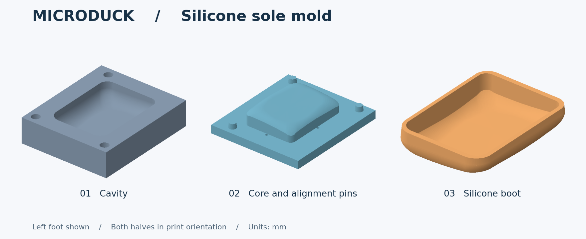

# MicroDuck 硅胶脚底翻模（正在尝试中）

**正在尝试中。** V1 单脚模具已收到使用者“非常好用”的反馈。目标是给标准版 MicroDuck 做一双在木地板上更抓地的硅胶脚套，防滑表现仍需具体地板实测。

**当前试制方案为 [V3.2 一双连体加厚版](v3-pair/README.md)**。左右共用一个下模和一个上盖，接地面与安装内腔平顺处理，下模 98 × 68 mm，整套打印两件，采用初版厚度和十六孔排气。V3.2 修正凸芯边缘波纹，导出模型逐只核对左右配合并提供合模剖面，实物试浇待验证。

[V2 八腔版](v2-batch8/README.md) 为此前的批量方案。

下文是 V1 单脚模具的文件和使用方法。

灰色下模形成接地面和外壁，蓝色上模的凸芯形成安装内腔。橙色是预期成品，约 **41.10 × 54.00 × 12.91 mm**。左右脚各有一套上、下模，采用原脚套名义尺寸，未加胶料收缩补偿。

## 下载和打印

每只脚选表中**同一行的两件**。优先选自带毫米单位的 3MF。如果代打平台只收 STL，按平台的导入单位选择对应行。打开文件后保持 **100% 缩放**。

| 文件格式及导入单位 | 左脚下模 / 上模 | 右脚下模 / 上模 |
|---|---|---|
| 3MF · 毫米（推荐） | [下模](3mf-mm/left_01_cavity_mm.3mf) / [上模](3mf-mm/left_02_core_mm.3mf) | [下模](3mf-mm/right_01_cavity_mm.3mf) / [上模](3mf-mm/right_02_core_mm.3mf) |
| STL · 平台按 mm 导入 | [下模](stl-mm/left_01_cavity.stl) / [上模](stl-mm/left_02_core.stl) | [下模](stl-mm/right_01_cavity.stl) / [上模](stl-mm/right_02_core.stl) |
| STL · 平台按 cm 导入 | [下模](stl-cm/left_01_cavity_IMPORT_AS_CM.stl) / [上模](stl-cm/left_02_core_IMPORT_AS_CM.stl) | [下模](stl-cm/right_01_cavity_IMPORT_AS_CM.stl) / [上模](stl-cm/right_02_core_IMPORT_AS_CM.stl) |

**下单前核对长边：四个模件都是 76 mm（7.6 cm）。** 下模外形为 64 × 76 × 18 mm，上模约为 68 × 76 × 16.91 mm。厘米版 STL 的坐标已除以 10，上传时无需再次缩放。

保持图中摆放方向，平背贴打印床，下模型腔朝上，上模凸芯与三根定位柱朝上。硬质 FDM 模具可从 PLA、0.16 mm 层高和 4 圈外壁起试。检查切片预览，保持型腔、分型面和四个排气孔清洁。接地面会复制模腔的打印层纹。

## 用哪种硅胶、每只配多少

首件可试**邵氏 A 20 度（Shore 20A）的高抗撕裂双组分加成型浇注硅胶**。按模型计算，单只净胶量约 **6.25 mL**，实际可备约 **8 mL 混合胶**，给杯壁残留和溢胶留余量。

以 Dragon Skin 20 普通版为例，密度 1.08 g/mL，A/B 可按重量 1∶1 混合。**每只称 A 胶 4.5 g + B 胶 4.5 g，一双共约 18 g。** 用同一套模具分两次浇，就分两次配胶。换型号时，按该产品标注的配比、操作时间和脱模时间操作。20A 是首试硬度，木地板抓地力要用成品实测。[厂家材料规格](https://www.smooth-on.com/products/dragon-skin-20/)

## 从试合到试装

1. **空模试合。** 把上模翻过来，对准下模的三个定位孔。用手轻压到分型面四周贴平，确认没有翘角再打开。先用少量胶在相同打印材料和表面处理的余料上试固化、试剥离。[材料相容性小样测试](https://www.smooth-on.com/support/faq/104/)
2. **在开模状态倒胶。** 将下模水平放在接胶垫上，用少量混合胶润湿凹腔四角和上模凸芯，再把余胶从下模一侧缓慢倒入。
3. **合模排气。** 上模凸芯朝下，三柱对孔，慢慢压到两块分型面贴平。观察上盖四个排气孔是否冒胶，从两侧均匀轻夹，保持孔口敞开，静置至材料规定的脱模时间。
4. **开模修边。** 松夹后利用上模两侧突出边交替轻抬，沿脚套上沿逐段剥离，修平排气孔留下的胶头和边缘飞边。
5. **在实际地板上试。** 胶料充分固化后，检查套口是否坐到底。先静态承重，再与原 TPU 脚套在同一块干净木地板、相同载荷下对比侧推是否容易滑动，最后低速走动和转向，观察卷边或脱套。

**只想先打印一套？** 可先打左模，浇一只。左脚试装后，将成品水平转 180° 再试右脚。原版左右脚为镜像，旋转后局部仍有偏差。只有两边实际试装和承重均合适，再用同一套模具浇第二只。

## 几何检查与来源

四个毫米 STL 回读均为单个封闭实体。数字合模后重建的脚套与原模型的双向体积差均小于 0.01 mm³（排气孔胶头除外）。输入模型哈希、成品尺寸、排气孔位置与合模体积差见[几何检查记录](checks.json)。

脚底几何源自 Pollen Robotics 的 Microduck，经 fanhao375 整理为标准左右脚底 STL。本项目据此制作两片式模具，增加定位柱、排气孔及开模边。本项目的模具几何与预览图按 CC BY-NC-SA 4.0 发布。[衍生模型许可](https://creativecommons.org/licenses/by-nc-sa/4.0/) · [原脚底文件](https://github.com/fanhao375/microduck-replica/tree/3599731c250a06648e18ca9fb1453b8a88410769/print/打印件) · [来源与许可说明](https://github.com/fanhao375/microduck-replica/blob/3599731c250a06648e18ca9fb1453b8a88410769/NOTICE.md) · [Pollen Robotics 原项目](https://github.com/pollen-robotics/microduck_rl)
