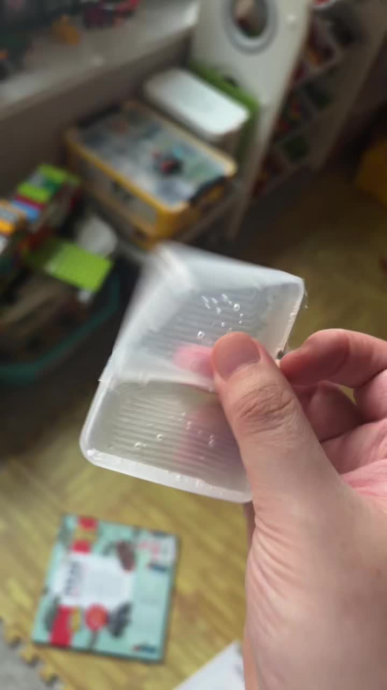
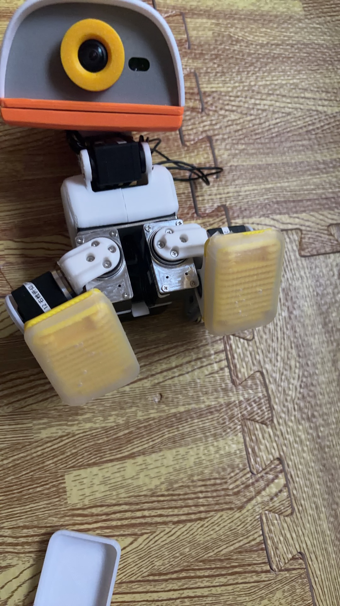

# 原尺寸硅胶脚套实测：固定方案已翻车

反馈日期：2026-11-08；整理更新：2026-11-09。以下记录来自制作者的实测反馈及随附照片、视频。

**V1 原尺寸版已实测失败：按照原模型尺寸翻出来的硅胶脚套，根本无法自行固定在脚架上，会直接脱落，目前只能靠皮筋兜住。** 原尺寸没有给这次硅胶成品提供足够的包紧量，因此原尺寸的固定方案不能直接使用。

**同时确认，本次使用的硅胶材质非常防滑。** 这是本次实物使用的反馈；具体胶料型号、硬度及摩擦系数尚未记录。后续继续使用硅胶方向，重点验证内壁加厚和上沿收口能否让脚套自行固定。皮筋仅是本次试验的临时固定方式。

## 实物记录

翻模得到的硅胶脚套：

脚套装到机器人上，以皮筋临时兜住：

[查看实测视频（MP4）](field-test.mp4)

## 后续四版：等待实验

[A–D 四种加厚方式](../../v7-trials/README.md) 已准备好左右上模，**全部等待实验，尚无实测结论**。

| 版本 | 侧壁单侧向内加厚 | 上沿单侧向内加厚 | 当前状态 |
|---|---|---|---|
| A | 1.5 mm | 1.5 mm | 等待实验 |
| B | 2.0 mm | 2.0 mm | 等待实验 |
| C | 1.0 mm | 2.0 mm | 等待实验 |
| D | 1.5 mm | 2.5 mm | 等待实验 |

后续观察能否装到位、是否可以不用皮筋自行固定，以及脱模、反复拆装和走动时是否撕裂或脱落，再根据实测结果选型。本次失败结论对应 V1 原尺寸版，A–D 四版继续保留“正在尝试中”状态。

[返回模具与使用方法](../../README.md)
