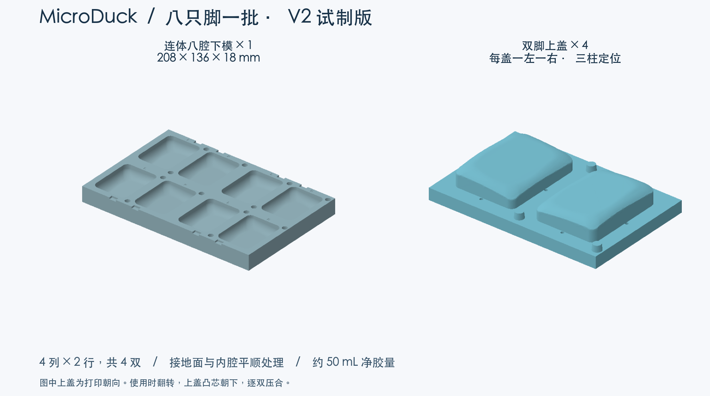

# MicroDuck 八腔硅胶脚套模具 V2

**正在尝试中。** V1 单脚模具已收到使用者“非常好用”的反馈。V2 根据该反馈增加八腔排布，并对接地面和安装内腔做平顺处理，目前完成数字几何检查，批量浇注和新表面配合仍待实测。

## 打印两种零件，共五件

| 零件 | 数量 | 实际尺寸 |
|---|---|---|
| batch8_base · 连体八腔下模 | 1 | 208 × 136 × 18 mm |
| pair_lid_print4 · 通用双脚上盖 | 4 | 103 × 67 × 17.91 mm |

八只脚按 **4 列 × 2 行**排列，包含四只左脚和四只右脚。每个上盖对应相邻的 L、R 两腔，四个上盖相同，可以逐双合模和开模。三根定位柱防止方向放错，外缘缺口供塑料撬片轻抬上盖。

保持文件内的打印朝向。下模凹腔朝上，上模凸芯与定位柱朝上，平背贴打印床。打印平台需容纳下模的 208 × 136 mm，并留出实际切片所需的裙边或 brim 空间。大平板的平整度影响合模，应先空合四个盖，确认四周接触后再浇胶。打印层高、支撑与腔面后处理按实际工艺检查。

- 文件名以 _mm.3mf 结尾的文件标注毫米单位，100% 导入。
- 文件名以 _mm.stl 结尾的文件供按毫米导入的平台使用，100% 导入。
- 文件名以 _IMPORT_AS_CM.stl 结尾的文件供按厘米导入的平台使用，100% 导入，坐标已除以 10。

**下单前核对长边。下模为 208 mm / 20.8 cm，上盖为 103 mm / 10.3 cm。**

| 格式 | 下模，打印 1 件 | 上盖，打印 4 件 |
|---|---|---|
| 毫米 3MF | [下载](batch8_base_mm.3mf) | [下载](pair_lid_print4_mm.3mf) |
| 毫米 STL | [下载](batch8_base_mm.stl) | [下载](pair_lid_print4_mm.stl) |
| 厘米导入 STL | [下载](batch8_base_IMPORT_AS_CM.stl) | [下载](pair_lid_print4_IMPORT_AS_CM.stl) |

## 两面平顺处理

内腔与接地面都做了网格平滑，中央面重新拟合成平面，并与周边圆弧渐变连接。保留原脚底的左右倾斜关系，以及安装口上部约 2.7 mm 的配合轮廓。网格简化容差为 0.005 mm。

在宽度 ±17 mm、长度 ±23 mm、1 mm 间距的竖直射线采样中，新表面相对旧表面的高度变化最大约 0.147 mm，底厚采样最小约 1.89 mm。平顺处理解决模型表面的小起伏，实物的打印层纹仍会随工艺复制到硅胶上。

## 一次做四双的流程

1. 先空合全部上盖，对照 L/R 标记确认定位柱入孔，分型面贴平。模具材料或表面处理有变化时，先做少量胶的固化与剥离试验。
2. 逐双操作。用少量混合胶薄涂对应的两个型腔和上盖凸芯，再分别向左右两腔倒胶。
3. 翻转双脚上盖，凸芯朝下，缓慢压合。每个型腔仍有四个直径约 1.9 mm 的排气孔，共八孔，观察出胶并保持孔口敞开。轻夹固定，避免盖板翘起或弯曲。
4. 依次完成其余三双，让八只脚套在同一底座内固化。胶的操作时间要覆盖本批配胶后的全部操作。若时间紧，可每双单独配胶。
5. 达到材料规定的脱模条件后，松夹，从外侧开模缺口交替轻抬每个盖，逐只剥离。修整胶头和飞边，充分固化后先检查两只的装机配合，再测试站立和走动。

每只净胶量仍约 **6.25 mL**，整批八只约 **49.96 mL**。按此前使用建议中的 Dragon Skin 20 普通版计算，每双可配 18 g 混合胶（A 9 g + B 9 g），四双合计约 **72 g（A 36 g + B 36 g）**，包含杯壁和溢胶损耗。换型号时按实际材料的密度与配比计算。20A 为首试硬度，木地板抓地效果以实测为准。[材料规格](https://www.smooth-on.com/products/dragon-skin-20/)

## 检查与来源

下模和上盖导出后回读均为单个封闭实体。数字合模未发现上下模实体交叠，沿开模方向分步检查至 13.75 mm。八腔重建的脚套与目标实体体积差合计约 0.043 mm³，来自排气孔口的局部胶料空间。结果见 [checks.json](checks.json)。

底层脚套模型来自 Pollen Robotics / microduck_rl，经 fanhao375 整理为标准左右脚底 STL。本次改动包含表面平顺处理、八腔排布、双脚上盖、定位与排气结构、L/R 标记和开模缺口。模具及预览图按 CC BY-NC-SA 4.0 发布。[固定来源](https://github.com/fanhao375/microduck-replica/tree/3599731c250a06648e18ca9fb1453b8a88410769/print/打印件) · [来源声明](https://github.com/fanhao375/microduck-replica/blob/3599731c250a06648e18ca9fb1453b8a88410769/NOTICE.md) · [原项目](https://github.com/pollen-robotics/microduck_rl) · [许可](https://creativecommons.org/licenses/by-nc-sa/4.0/)
