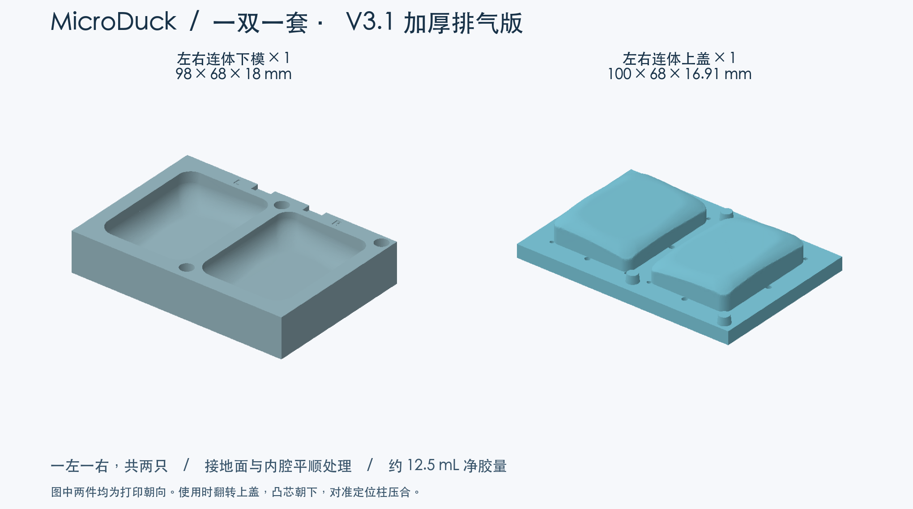

# MicroDuck 一双连体硅胶模具 V3.1

**正在尝试中。** 按一双一套设计，左右两个型腔连在同一个下模上，两个凸芯连在同一个上盖上，整套只需打印两件。接地面和安装内腔沿用 V2 的平顺处理。V3.1 按初版厚度采用 18 mm 下模和 6 mm 上盖底板，并补充角部排气。实际打印平整度、排气和夹持效果仍待试浇验证。

| 零件 | 数量 | 实际尺寸 | 毫米 3MF | 毫米 STL | 按厘米导入的 STL |
|---|---|---|---|---|---|
| 左右连体下模 | 1 | 98 × 68 × 18 mm | [下载](pair_base_mm.3mf) | [下载](pair_base_mm.stl) | [下载](pair_base_IMPORT_AS_CM.stl) |
| 左右连体上盖 | 1 | 100 × 68 × 16.91 mm | [下载](pair_lid_mm.3mf) | [下载](pair_lid_mm.stl) | [下载](pair_lid_IMPORT_AS_CM.stl) |

下单前核对长边。**下模 9.8 cm，上盖 10 cm。** 根据平台导入单位选文件，全部按 100% 导入。厘米版 STL 的坐标已除以 10。

## 省料与打印

- 下模最薄底板约 5.09 mm，上盖底板厚 6 mm，采用三柱定位、十六个排气孔、L/R 标记和开模缺口。
- 两件实体总体积约 147.61 cm³，相对 V1 一双四件的 224.20 cm³ 减少约 **34.2%**。这个比例是几何体积对比，实际打印耗材由外壁、填充、顶底层及支撑设置决定。
- 两件均以文件内的平背贴床。下模凹腔朝上，上盖凸芯朝上。可沿用已验证的打印材料与表面处理，切片时检查型腔下方形成连续底层。打印后先空合，三柱入孔，确认分型面四周贴平。

## 使用

1. 将下模放平，按 L/R 找到左右型腔。上盖翻转后，对准三根柱子试合一次。
2. 配胶后，用少量胶润湿型腔与凸芯，分别向左右两个型腔倒胶。
3. 上盖凸芯朝下，缓慢压到分型面贴合，观察十六个排气孔出胶。两侧均匀轻夹，孔口保持敞开。
4. 按材料说明等待固化，再从缺口交替轻抬上盖，逐只剥离脚套并修边。

每双净胶量约 **12.49 mL**。按此前推荐的 Dragon Skin 20 普通版，含损耗每双可配约 **18 g 混合胶，A 9 g + B 9 g**。其他型号按自身密度与配比计算。[材料规格](https://www.smooth-on.com/products/dragon-skin-20/)

## 排气和气泡

每只脚有四个直径 2.4 mm 的边部主排气孔，加四个直径 1.8 mm 的角部孔，整套十六孔。孔口上端有 1 mm 深的扩口，便于观察和清理溢胶。新增孔位位于脚套上沿，脱模后需修平对应的小胶头。孔径和数量为本次试制参数，效果待首浇确认。

这些孔帮助合模时排出型腔空气。混合胶中细泡的减少还取决于搅拌与脱泡。先慢速混合并刮匀杯壁，再按胶料说明脱泡。Dragon Skin 20 厂家建议真空脱泡，从最低处单点缓慢倒胶。[厂家说明](https://www.smooth-on.com/products/dragon-skin-20/)

没有脱泡设备时，可先用薄胶润湿型腔四角和凸芯，再从一侧细流倒入，缓慢合模，保持所有孔口敞开。首件检查表面气孔和边角是否缺胶，再决定是否进一步调整工艺。

## 平顺处理和检查

接地面与内腔均做网格平滑，中央面拟合为平面并与圆弧过渡。原脚套的左右倾斜关系与安装口上部约 2.7 mm 配合轮廓予以保留。V3.1 脚套几何与 V2 相同，打印层纹仍会受打印工艺影响。

导出的上下模均为单一封闭实体，数字合模与分步开模检查通过，三种格式按对应单位换算后尺寸一致。一双脚套的数字重建体积差约 0.074 mm³，来自排气孔口的局部胶料空间。[几何检查记录](checks.json)

脚套基础几何来自 Pollen Robotics / microduck_rl，经 fanhao375 整理。本项目的模具与预览图采用 CC BY-NC-SA 4.0。此次改动为平顺双脚型腔、连体下模与上盖、按初版厚度设置板材、缩小边框并增加角部排气。[固定来源](https://github.com/fanhao375/microduck-replica/tree/3599731c250a06648e18ca9fb1453b8a88410769/print/打印件) · [来源说明](https://github.com/fanhao375/microduck-replica/blob/3599731c250a06648e18ca9fb1453b8a88410769/NOTICE.md) · [原项目](https://github.com/pollen-robotics/microduck_rl) · [许可](https://creativecommons.org/licenses/by-nc-sa/4.0/)
