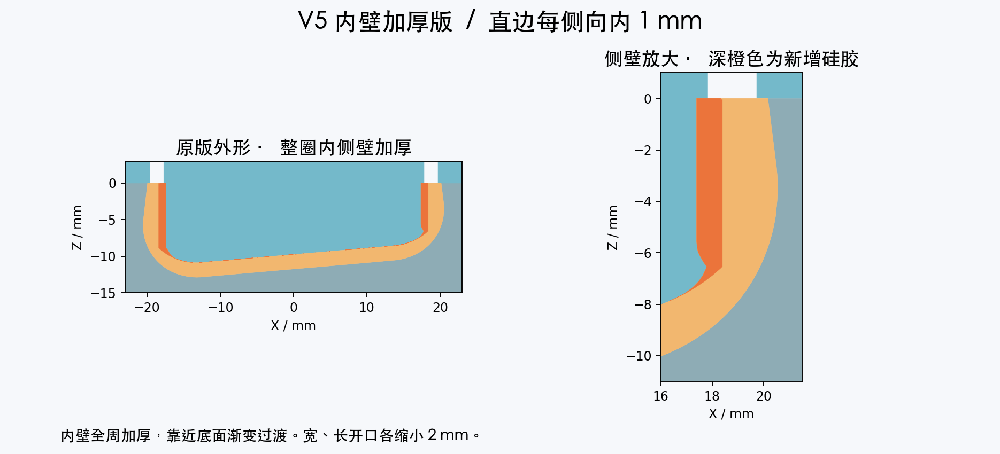

# MicroDuck 原纹理内壁加厚模具 V5

**正在尝试中。** 根据实测“脚套能套入，但太松容易脱落，单侧空隙估计约 1 mm”的反馈，回到最初 V1 的左右分体模具与原脚套外形，在整圈内侧壁增加包紧量。本次首试取直边每侧向内 1 mm，到底部圆弧渐变接回原内腔。

## 本次尺寸

- 开口内尺寸从约 36.8 × 49.8 mm 调整到 **34.8 × 47.8 mm**，宽、长各收小 2 mm。
- 直边全周内收 1 mm，圆角按相同比例过渡。靠近倾斜底面，从距拟合底面 0.5 mm 到 2.5 mm 的范围渐变到完整内收，中央底面按原安装深度制作。
- 每只净胶量约 **7.61 mL**，比原件增加约 1.36 mL。考虑杯壁和溢胶损耗，首浇可准备约 **10 mL 混合胶/只**。按实际胶料的密度和 A/B 配比称量。
- 每侧 1 mm 来自实物空隙的估计，实际夹持、拉脱和走动效果待首件试套。先浇一只，充分固化后检查能否坐到底、是否仍易脱落。

## 下载与打印

恢复左右分开的两套模具，每套上、下模各一件。

| 零件 | 数量 | 毫米 STL | 毫米 3MF | 按厘米导入 STL |
|---|---|---|---|---|
| 左脚下模 | 1 | [下载](left_01_cavity.stl) | [下载](left_01_cavity.3mf) | [下载](left_01_cavity_IMPORT_AS_CM.stl) |
| 左脚上模 | 1 | [下载](left_02_core.stl) | [下载](left_02_core.3mf) | [下载](left_02_core_IMPORT_AS_CM.stl) |
| 右脚下模 | 1 | [下载](right_01_cavity.stl) | [下载](right_01_cavity.3mf) | [下载](right_01_cavity_IMPORT_AS_CM.stl) |
| 右脚上模 | 1 | [下载](right_02_core.stl) | [下载](right_02_core.3mf) | [下载](right_02_core_IMPORT_AS_CM.stl) |

**如果已有最初 V1 的左右下模，可直接配本版对应上模，只需打印两个新上模。** 数字几何核对结果显示，下模与 V1 的体积差为零。中间版本的连体模具按各自版本配套使用。

下模尺寸为 **64 × 76 × 18 mm**，上模约 **68 × 76 × 16.91 mm**。四件长边均应为 **76 mm / 7.6 cm**。按平台导入单位选文件，缩放保持 100%。毫米 3MF 已声明单位，厘米版 STL 坐标已除以 10。

保持文件内朝向，平背贴床。下模凹腔朝上，上模凸芯和定位柱朝上。沿用已成功打印 V1 的材料与工艺，先空模试合确认三柱入孔、四周贴平。左右文件分别配对。

## 使用

1. 下模放平，用少量混合胶润湿型腔与凸芯，再从一侧缓慢倒胶。
2. 翻转上模，凸芯朝下，对准三个定位柱，缓慢压合。每只四个直径 1.9 mm 排气孔位于加厚后的上沿，观察出胶，轻夹固定。
3. 等到胶料说明规定的脱模时间，从两侧交替轻抬上模，再沿脚套开口逐圈翻起、剥离，修平胶头和飞边。
4. 胶料充分固化后再套入对应脚架，检查能否坐到底、边缘是否抱紧，先静态承重再低速走动。记录此次胶料型号、硬度和实际配合，便于根据首件调整内收量。

## 几何验证与来源

四件毫米 STL、厘米导入 STL 和 3MF 均回读检查。下模与 V1 几何一致，外侧轮廓及纹理由原件形成。中央底面射线采样确认安装深度。左右分别检查合模、刚性开模路径，并检查左右上模混用时的定位干涉。[尺寸与胶量记录](checks.json) · [导出装配检查](assembly-checks.json)

原脚套几何来自 Pollen Robotics / microduck_rl，经 fanhao375 整理为标准左右脚底 STL。本次改动为整圈内壁加厚、底部过渡与排气孔位置适配。衍生模具和预览图按 CC BY-NC-SA 4.0 发布。[固定来源](https://github.com/fanhao375/microduck-replica/tree/3599731c250a06648e18ca9fb1453b8a88410769/print/打印件) · [来源说明](https://github.com/fanhao375/microduck-replica/blob/3599731c250a06648e18ca9fb1453b8a88410769/NOTICE.md) · [原项目](https://github.com/pollen-robotics/microduck_rl) · [许可](https://creativecommons.org/licenses/by-nc-sa/4.0/)
