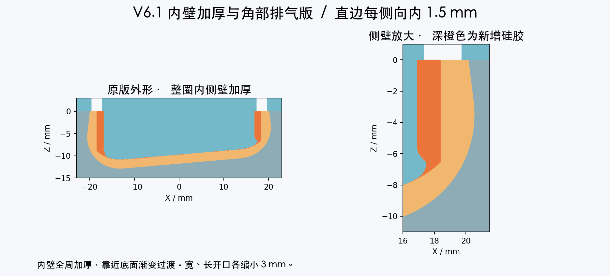
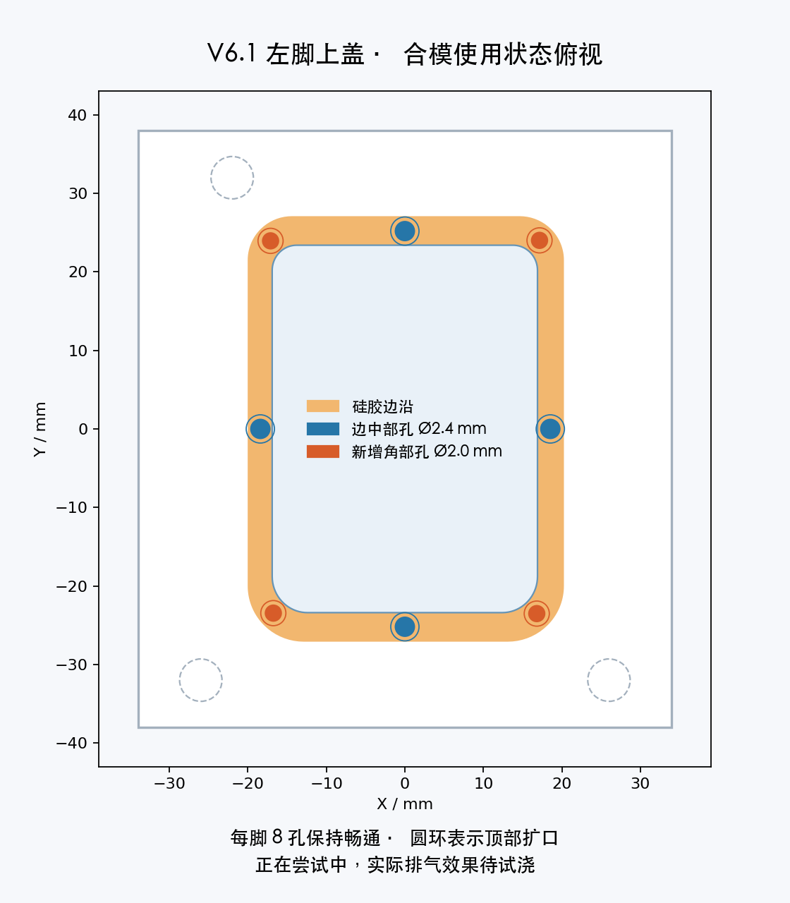

# MicroDuck 原纹理内壁加厚模具 V6.1

**正在尝试中。** 根据实测“脚套能套入，但太松容易脱落，单侧空隙估计约 1 mm”的反馈，回到最初 V1 的左右分体模具与原脚套外形，在整圈内侧壁增加包紧量。本次按进一步收紧的要求，取直边每侧向内 1.5 mm，到底部圆弧渐变接回原内腔。另针对圆滑缺边、且用户反馈上次已多加胶的情况，增加角部排气，实际缺陷原因及改善效果待试浇确认。

## 本次尺寸

- 开口内尺寸从约 36.8 × 49.8 mm 调整到 **33.8 × 46.8 mm**，宽、长各收小 3 mm。
- 直边全周内收 1.5 mm，圆角按相同比例过渡。靠近倾斜底面，从距拟合底面 0.5 mm 到 2.5 mm 的范围渐变到完整内收，中央底面按原安装深度制作。
- 每只净胶量约 **8.27 mL**，比原件增加约 2.02 mL。考虑杯壁和溢胶损耗，首浇可准备约 **11 mL 混合胶/只**。按实际胶料的密度和 A/B 配比称量。
- 每侧 1.5 mm 是在原脚套偏松的反馈上进一步收紧的试制值。对原脚架 36.8 × 49.8 mm 的下部装入截面，按尺寸比计算，开口需在宽度方向撑开约 8.9%、长度方向约 6.4%。这些数值为几何估算，实际安装力、夹持和走动防脱效果待首件试套。先浇一只，充分固化后检查能否坐到底、是否仍易脱落。

## 下载与打印

恢复左右分开的两套模具，每套上、下模各一件。

| 零件 | 数量 | 毫米 STL | 毫米 3MF | 按厘米导入 STL |
|---|---|---|---|---|
| 左脚下模 | 1 | [下载](left_01_cavity.stl) | [下载](left_01_cavity.3mf) | [下载](left_01_cavity_IMPORT_AS_CM.stl) |
| 左脚上模 | 1 | [下载](left_02_core.stl) | [下载](left_02_core.3mf) | [下载](left_02_core_IMPORT_AS_CM.stl) |
| 右脚下模 | 1 | [下载](right_01_cavity.stl) | [下载](right_01_cavity.3mf) | [下载](right_01_cavity_IMPORT_AS_CM.stl) |
| 右脚上模 | 1 | [下载](right_02_core.stl) | [下载](right_02_core.3mf) | [下载](right_02_core_IMPORT_AS_CM.stl) |

**如果已有最初 V1 的左右下模，可直接配本版对应上模，只需打印两个新上模。** 数字几何核对结果显示，下模与 V1 的体积差为零。中间版本的连体模具按各自版本配套使用。

下模尺寸为 **64 × 76 × 18 mm**，上模约 **68 × 76 × 16.91 mm**。四件长边均应为 **76 mm / 7.6 cm**。按平台导入单位选文件，缩放保持 100%。毫米 3MF 已声明单位，厘米版 STL 坐标已除以 10。

保持文件内朝向，平背贴床。下模凹腔朝上，上模凸芯和定位柱朝上。沿用已成功打印 V1 的材料与工艺，先空模试合确认三柱入孔、四周贴平。左右文件分别配对。

## 使用

1. 下模放平，每只准备约 11 mL 混合胶，按实际材料比例混匀。先用少量胶薄薄润湿型腔四角、上沿及凸芯，再从一侧缓慢倒胶，让胶自行铺开。
2. 翻转上模，凸芯朝下，对准三个定位柱，缓慢压合。每只设四个直径 2.4 mm 的边中部孔和四个直径 2.0 mm 的角部孔，孔口有 1 mm 深扩口。观察八孔排气、出胶，保持孔口敞开，再均匀轻夹固定。
3. 等到胶料说明规定的脱模时间，从两侧交替轻抬上模，再沿脚套开口逐圈翻起、剥离，修平胶头和飞边。
4. 胶料充分固化后再套入对应脚架，检查能否坐到底、边缘是否抱紧，先静态承重再低速走动。记录此次胶料型号、硬度和实际配合，便于根据首件调整内收量。

## 排查圆滑缺边

实测反馈为缺口圆滑、像没浇满或气泡，用户补充上次怕胶不够，已经多放了胶。因此不再把总配胶量不足列为首要判断，优先排查合模时边角困气、局部润湿不足、排气孔堵塞或胶已变稠。大量溢胶也不能证明每个角落已经填满。具体模具版本、实际倒入量和合模过程尚未确认，缺陷原因仍待验证；当前增设角部排气属于有针对性的试制调整。

V6.1 每只成品净胶量约 8.27 mL，八个孔还会容纳额外溢胶。11 mL 为新版每只的配胶准备量，需计入杯壁、薄涂和溢胶损耗，不代表需要在上次基础上继续增加。先薄涂角部、保持模具水平、缓慢合盖，避免一下压到底。合模时观察每个孔，若有孔一直不出胶，先排查孔堵塞、模具不水平、胶量不足或胶已开始变稠。孔出胶也需配合脱模后的完整性检查判断。

较黏的硅胶可能保留混合时带入的细泡。按所用胶料说明进行脱泡，倒胶从低处单点缓慢进行。[厂家气泡说明](https://www.smooth-on.com/support/faq/85/) · [Dragon Skin 20 的浇注与脱泡说明](https://www.smooth-on.com/products/dragon-skin-20/)

## 几何验证与来源

四件毫米 STL、厘米导入 STL 和 3MF 均回读检查。下模与 V1 几何一致，外侧轮廓及纹理由原件形成。中央底面射线采样确认安装深度。左右分别检查合模、刚性开模路径，并检查左右上模混用时的定位干涉。[尺寸与胶量记录](checks.json) · [导出装配检查](assembly-checks.json)

原脚套几何来自 Pollen Robotics / microduck_rl，经 fanhao375 整理为标准左右脚底 STL。本次改动为整圈内壁加厚、底部过渡、四角排气及孔口扩口。衍生模具和预览图按 CC BY-NC-SA 4.0 发布。[固定来源](https://github.com/fanhao375/microduck-replica/tree/3599731c250a06648e18ca9fb1453b8a88410769/print/打印件) · [来源说明](https://github.com/fanhao375/microduck-replica/blob/3599731c250a06648e18ca9fb1453b8a88410769/NOTICE.md) · [原项目](https://github.com/pollen-robotics/microduck_rl) · [许可](https://creativecommons.org/licenses/by-nc-sa/4.0/)
