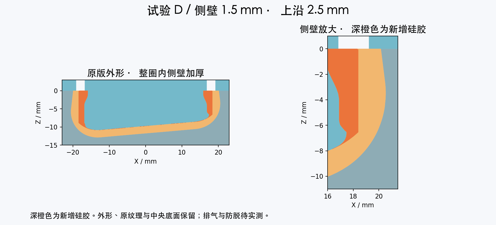

# D 版：侧壁 1.5 → 上沿 2.5 mm

**正在尝试中。** [完整说明与对比](../README.md)。上盖背面刻有 D-L / D-R。

配 [公共左下模](../common/left_01_cavity.3mf) / [公共右下模](../common/right_01_cavity.3mf)，已有 V1 对应下模可复用。

| 上模 | 毫米 3MF | 毫米 STL | 按厘米导入 STL |
|---|---|---|---|
| 左脚 | [下载](left_02_core.3mf) | [下载](left_02_core.stl) | [下载](left_02_core_IMPORT_AS_CM.stl) |
| 右脚 | [下载](right_02_core.3mf) | [下载](right_02_core.stl) | [下载](right_02_core_IMPORT_AS_CM.stl) |

开口约 31.8 × 44.8 mm，每只净胶量约 8.66 mL，首浇准备约 12 mL 混合胶。此为准备量，包含薄涂、孔道和损耗，不代表需要继续加大此前的浇注量。配胶比例按所用产品说明。

[几何与胶量记录](checks.json) · [导出和装配检查](assembly-checks.json)
