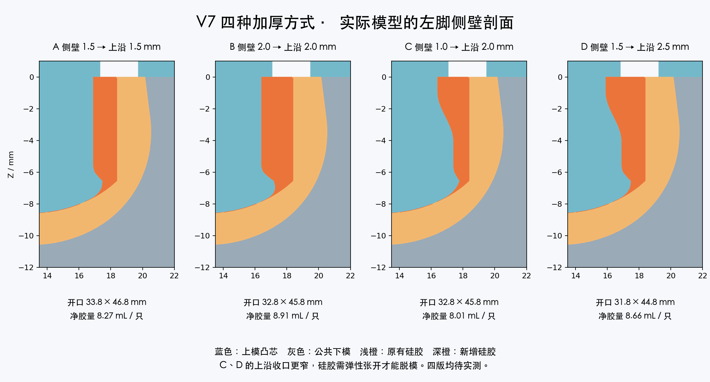

# MicroDuck 硅胶脚套 V7 四方案试验组

**正在尝试中，A、B、C、D 四版均等待实验，尚无实测结论。** 针对原脚套太松、估计单侧约 1 mm 空隙、会直接脱落的问题，一次比较不同内壁加厚方式。另有“胶已多放仍出现圆滑缺边”的反馈：各版统一使用 V6.1 八孔排气，优先排查边角困气和局部充填；不能以溢胶多判断充填完整。

**原尺寸版最新实测已翻车：** 硅胶脚套无法自行固定，只能靠皮筋兜住；本次硅胶材质的防滑效果已得到实测肯定。[照片、视频与反馈记录](../experiments/2026-11-08-original-size/README.md)。此次失败对应 V1 原尺寸版。

保留最初的外形与纹理，左右分开，每脚上下两件。四版共用 V1 左右下模，只更换上模。A 是 V6.1 配合尺寸的对照版；所有上盖背面刻有 A-L 至 D-R，L 左、R 右。

## 四版尺寸

下表为直边单侧的向内加厚量，圆角按比例过渡；不是把整个脚套缩放。净胶量按左右较大值列出。

| 版号 | 侧壁／上沿加厚 mm | 开口宽 × 长 mm | 按原脚架估算撑开量（宽／长） | 每只净胶量 mL | 首浇每只准备混合胶 mL |
|---|---|---|---|---|---|
| A | 整圈 1.5 | 33.8 × 46.8 | 8.9% / 6.4% | 8.27 | 11 |
| B | 整圈 2.0 | 32.8 × 45.8 | 12.2% / 8.7% | 8.91 | 12 |
| C | 侧壁 1.0 → 上沿 2.0 | 32.8 × 45.8 | 12.2% / 8.7% | 8.01 | 11 |
| D | 侧壁 1.5 → 上沿 2.5 | 31.8 × 44.8 | 15.7% / 11.2% | 8.66 | 12 |

- **A：整圈内收 1.5 mm。** 与 V6.1 同一内腔，作为对照。
- **B：整圈内收 2.0 mm。** 比 A 全周更紧，用于比较整体包紧。
- **C：侧壁内收 1.0 mm，上沿到 2.0 mm。** 较宽内腔配较紧开口，用于比较主要靠上沿 扣住的方式。
- **D：侧壁内收 1.5 mm，上沿到 2.5 mm。** 加强上沿收口，为本组更紧的试验档。

C、D 从开口以下 4 mm 到 1 mm 平滑过渡到更大的内收量，最上方 1 mm 保持完整收口。四版靠近倾斜底面均渐变接回原内腔，中央底面与安装深度保持原版。

上述撑开量按原脚架下部约 36.8 × 49.8 mm 与开口尺寸比估算，**不能据此保证装得上或不脱落**。实际胶料硬度、伸长、撕裂强度、摩擦与固化状态都会影响结果；本次未做材料收缩补偿。C、D 有内腔大于开口的收口结构，脱模时硅胶也要弹性张开，可能比 A、B 更费力。充分固化后逐圈剥离，若边缘撕裂则记录为该方案的脱模问题。



## 下载与打印

[公共左右下模](common/) · [A 上模](A/README.md) · [B 上模](B/README.md) · [C 上模](C/README.md) · [D 上模](D/README.md)

- 先做一只左脚的四版比较：打印 A/B/C/D 四个左上模，共用一个左下模。若已有 V1 左下模，无需重打下模。
- 四版都做成双脚：八个上模配两个公共下模，共十件。每次用一套下模逐版浇注，不是同时浇四双。
- 毫米 3MF 内声明单位，优先使用；普通 STL 按 mm 导入；`_IMPORT_AS_CM.stl` 按 cm 导入。均为 100% 缩放，**长边必须是 76 mm（7.6 cm）**。
- 下模 64 × 76 × 18 mm，上模约 68 × 76 × 16.91 mm。保持文件朝向，平背贴床，上模凸芯和定位柱朝上；背面标识为浅凹字。
- 每版 L 上模配公共 L 下模，R 配 R。三柱定位带左右防错，但仍应先核对字样并空模试合。

## 用同一工艺做比较

1. 同一型号、硬度和批次的硅胶，按厂家比例与操作时间配胶。各版记录实际倒入量；表中的准备量包括损耗，不是保证充填的硬性用量。
2. 下模放平，薄涂四角、边沿和凸芯，缓慢从一处倒胶。慢慢合盖，保持四个 Ø2.4 mm 边中孔与四个 Ø2.0 mm 角部孔敞开，观察排气、出胶后轻夹。不要一下压到底或盲目继续加胶。
3. 按同一固化条件脱模、修去孔道胶头和飞边。先检查缺边、气泡、撕裂；有缺陷的成品不要拿来直接比较防脱。
4. 完整固化后，在同一只脚架上按 A → C → B → D 试套。记录能否坐到底、安装难度、边缘是否卷起、轻拉是否脱落。最紧不一定最好：优先选择装到位、无撕裂且不易脱落的版本。
5. 选出候选后再做对应右脚，并用**同版左右一对**测试木地板站立、低速走动和反复拆装。外侧接地纹理一致，但厚度变化仍可能影响变形与抓地，需实际比较。

使用 [试验记录表](trial-record.csv) 记录每版左右结果；尤其记录缺边位置、脱模撕裂以及是否完全坐到底。现有模具与真实胶料的公差仍需首件验证。

## 验证与重建

已逐件验证毫米 STL、厘米 STL 与 3MF 的封闭性、单实体、单位与尺寸；核对 V1 下模兼容、同侧合模与开模路径、左右混用干涉、排气孔落在边沿区域内。各目录有检查记录。几何检查不等同于柔性脱模、夹持力或防滑实测。

[build.py](build.py) 和 [verify.py](verify.py) 提供生成与复核脚本。原始脚套 STL 以米为单位，生成时乘 1000；指定原始模型目录与输出目录。`verify.py` 的参考目录包含 V1 毫米 STL。

```sh
uv run --script build.py --source-dir /path/to/original/打印件 --output-dir /path/to/output/A --variant A
uv run --with numpy --with trimesh --with manifold3d --with mapbox-earcut --with scipy --with shapely --with matplotlib --with networkx --with lxml python verify.py --output-dir /path/to/output/A --reference-dir /path/to/V1/stl-mm
```

将 `--variant` 改为 B、C、D 可生成其余版本。生成目录会包含下模，发行包只在 common 保留一份；下模几何一致。

## 来源与许可

原脚套几何来自 Pollen Robotics / microduck_rl，经 fanhao375 整理为标准左右脚底 STL。本次为内壁加厚、上沿渐变收口、八孔排气及上盖标识的衍生试制。模具、预览图与生成脚本按 CC BY-NC-SA 4.0 发布。

[固定来源](https://github.com/fanhao375/microduck-replica/tree/3599731c250a06648e18ca9fb1453b8a88410769/print/打印件) · [来源说明](https://github.com/fanhao375/microduck-replica/blob/3599731c250a06648e18ca9fb1453b8a88410769/NOTICE.md) · [原项目](https://github.com/pollen-robotics/microduck_rl) · [许可](https://creativecommons.org/licenses/by-nc-sa/4.0/)
