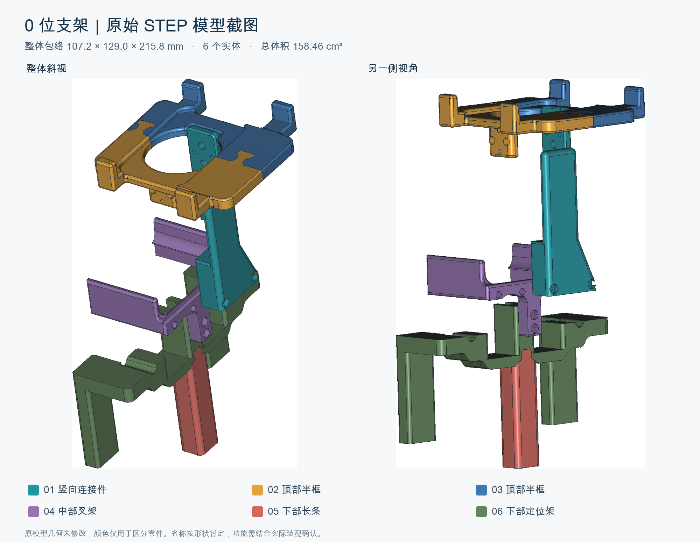

# 零位标定支架

配合 [网页标定工具](../calibrator/README.md) 使用的 6 件式零位定位工装。文件由 `0位支架.stp` 导出，每件各打印 1 个；本目录收录原设计 STL、装配参考图和打印说明。

**本版保留原始几何，未做简化、减料或配合修正。05 与 06 在原始装配位置存在约 26.08 mm³ 的几何交叠，代打前需核对这一处配合。尚无本目录版本的打印装配验收记录。**

图中颜色用于区分零件，名称按形状暂定；这是装配位置参考，不是打印摆放方向，也不是与整机安装完成的示意图。

## 下载与零件清单

点击下面的 STL，再使用 GitHub 的下载原始文件按钮；也可克隆仓库后将整个 `stl/` 目录交给代打商家。STL 本身不携带单位，请明确使用 **毫米（mm）、100% 比例**，不要自动缩放。

| 编号 | STL 文件 | 数量 | 导出方向下的包络尺寸 X × Y × Z（mm） |
|---|---|---|---|
| 01 | [竖向连接件](stl/01_竖向连接件.stl) | 1 | 24.00 × 35.95 × 105.39 |
| 02 | [顶部半框 A](stl/02_顶部半框A.stl) | 1 | 92.31 × 61.30 × 36.21 |
| 03 | [顶部半框 B](stl/03_顶部半框B.stl) | 1 | 92.31 × 49.95 × 18.26 |
| 04 | [中部叉架](stl/04_中部叉架.stl) | 1 | 51.64 × 70.00 × 46.00 |
| 05 | [下部长条](stl/05_下部长条.stl) | 1 | 15.00 × 17.61 × 67.15 |
| 06 | [下部定位架](stl/06_下部定位架.stl) | 1 | 39.11 × 129.00 × 74.44 |

原始装配包络约 **107.23 × 129.00 × 215.77 mm**，CAD 实体总体积约 **158.46 cm³**。实体体积不等于切片耗材量或打印报价，实际费用由打印朝向、支撑、填充、材料和商家工艺决定。

## 给代打商家的说明

可直接将以下内容随 6 个 STL 一起发送：

> 共 6 个独立零件，每件各 1 个。按毫米、100% 比例打印，不自动缩放。文件仅做了 XY 居中和最低点归零，当前方向不是指定打印方向，请根据结构选择摆放、支撑和工艺。保留定位面、连接孔和拼接结构，避免支撑残留影响配合。请先检查 05 下部长条与 06 下部定位架的交叠问题，确认处理方式后再生产。装配参考见随附图片。

没有随包提供经过试打验证的材料、层高、填充率、孔补偿或螺丝清单。连接件规格、孔径公差和与实际鸭子接触的位置需在生产前核对；不要凭文件名猜测紧固件规格。

## 装配与使用

1. 清理支撑和毛边，按图中编号确认 6 个零件，先空装检查连接孔、拼接处和定位面。05 / 06 的交叠尚未修正，不能以强压装入代替配合核对。
2. 在舵机断力、机身有人托稳的状态下，核对工装与自己这版机身的接触位置和间隙；当前资源未验证所有 MicroDuck 外壳与舵机版本。不要利用工装强迫关节越过机械限位。
3. 用工装辅助核对机械零位，再在网页中选择对应 ID，手动摆正、稳定采样并保存这一颗零位。具体操作见 [标定步骤](../calibrator/docs/usage.md#操作)。
4. 执行“使能保持”“回机械零位”或“回 HOME 并保持”前，确认工装没有锁住或挡住运动关节，并另行确认躯干固定、双腿悬空和头颈活动空间。零位定位工装不等于经过承重验证的整机运动支架；有接触干涉的定位件应先移除。
5. HOME 是站立参考角度，与机械零位不同。不要将工装限制下的错误姿态或 HOME 姿态保存为机械零位；不要将网页回 HOME 当作装配试验。

## 导出与核验记录

- 源文件名：`0位支架.stp`；本次仅收录 STL，不包含 STEP 源文件。
- 导出时间：2026-10-25；发布前复核：2026-11-01。
- FreeCAD 网格化参数：线性偏差 0.05 mm，角度偏差 0.15 rad。
- 每件仅平移到 XY 包络中心归零、最低 Z 为零；没有旋转、缩放或修改实体。
- 6 个 STL 与此前交付的打印文件逐字节一致；复核均为封闭边网格，每条无向边恰由 2 个三角面共享，体积与 CAD 实体差异均小于 0.1%。这不等同于装配、强度或实际打印验收。
- [manifest.json](manifest.json) 记录源文件 SHA-256、各 STL 的 SHA-256、三角面数、尺寸和体积，便于核对下载文件。

## 来源与许可

源模型由仓库维护者提供，原始设计作者、上游链接和模型许可尚待补充。本目录的 STL 与模型截图不自动适用仓库的软件 MIT 许可；此处仅记录已收到的模型与导出关系，不另行声明模型版权归属或授予新增使用权。后续获得来源信息时同步补充署名和许可。说明文字与校验脚本适用仓库根目录 MIT 许可。
